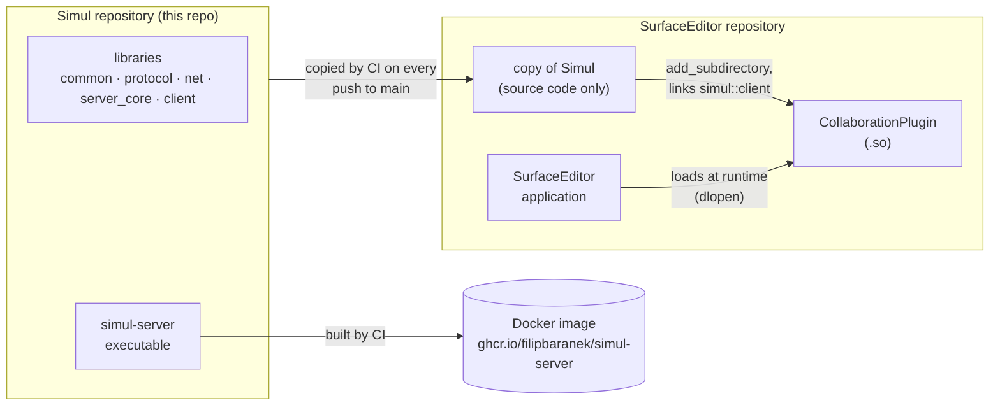
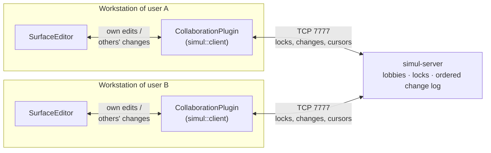

# Simul

Simul is a C++20 client-server framework for real-time collaborative editing. A dedicated,
authoritative server hosts lobbies, orders operations, and manages object locks and versions, while
clients apply the changes to their own data model. The server is application-agnostic: it never
interprets the edited data, only opaque payloads.

## Status

Work in progress. Simul is being developed as part of the diploma thesis *Podpora pre kolaboratívnu
simultánnu editáciu 3D modelov v reálnom čase* (Support for collaborative simultaneous real-time
editing of 3D models). Its first integration target is the 3D modelling application
[SurfaceEditor](https://github.com/iomko/SurfaceEditor).

## How Simul works with SurfaceEditor

Simul does not depend on SurfaceEditor. The integration lives on the SurfaceEditor side, in a
**CollaborationPlugin** that links the Simul client library.

### Code and build



- After every push to `main` that passes CI, the pipeline copies Simul's source code into the
  SurfaceEditor repository as a single commit that references the Simul commit it came from. Simul's
  own commit history is not copied.
- The plugin builds that copy with `add_subdirectory` and links only `simul::client`. The server is
  never part of SurfaceEditor; it runs as a Docker container on a remote host.

### At runtime



| Part | Responsibility |
|---|---|
| SurfaceEditor | Scene, meshes, tools, rendering. Knows nothing about networking. |
| CollaborationPlugin | Translates SurfaceEditor edits into Simul operations and back: serialises a change into a payload, applies incoming changes on the main (OpenGL) thread, rolls back rejected ones, shows other users' cursors and locks. |
| `simul::client` | Connection, login, lobbies, locks, ordering of incoming changes. Runs its own network thread and hands events to the host application. |
| `simul-server` | Hosts lobbies, assigns every change a global order number, checks locks and object versions. Treats payloads as opaque bytes and never sees geometry. |

## Requirements

- Linux
- GCC 14+ or Clang 18+
- CMake 3.25+
- Git

Third-party libraries (Asio, spdlog, Catch2) are downloaded automatically during the CMake configure
step.

## Build and test

```sh
cmake --preset debug
cmake --build --preset debug
ctest --preset debug
```

Available presets: `debug`, `release`, `asan` (AddressSanitizer + UndefinedBehaviorSanitizer).

## Repository layout

```
libs/       libraries (common, protocol, net, server_core, client)
apps/       executables (simul-server, simul-bot)
tests/      unit tests (simul-tests)
cmake/      CMake helper modules (dependencies, compiler warnings)
deploy/     deployment configuration (Docker Compose)
```
